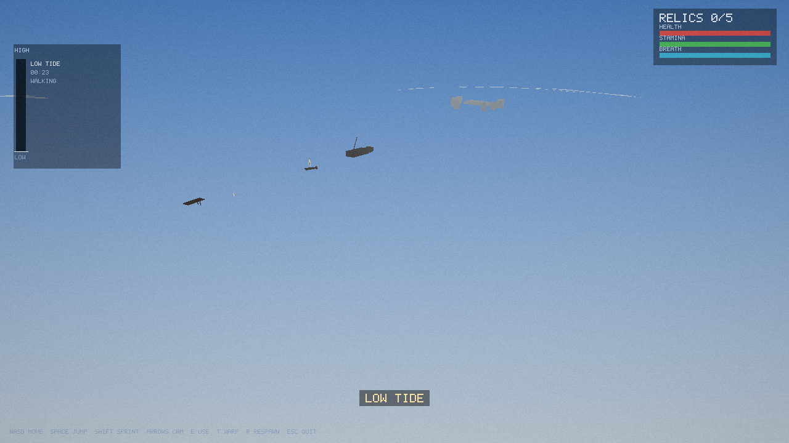
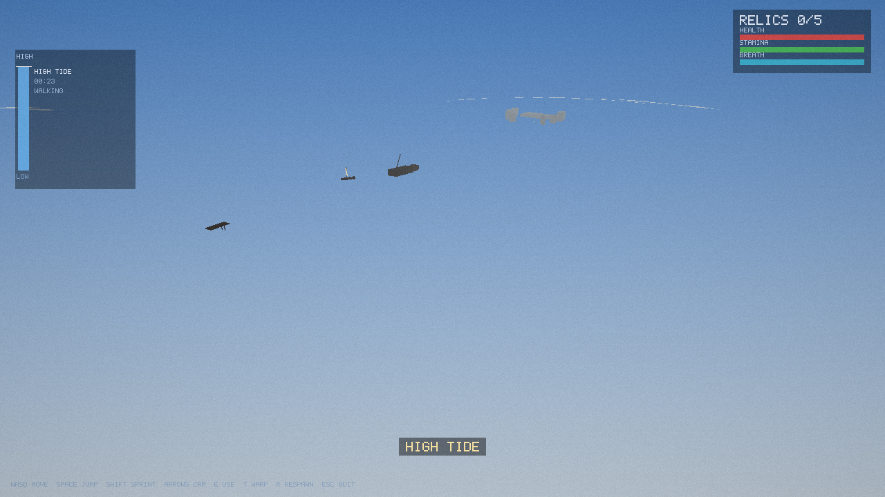

# Tidewalker

An open-world adventure on a coastal archipelago where **the tide goes out for
miles twice a day — and the map changes on a clock.**

At **low tide** you walk the exposed seabed to shipwrecks, sunken shrines and
flooding grottos. At **high tide** those places are underwater: you sail or
swim, and new surface routes open. Scout a spot, plan around the tide, get in,
and get out before the water comes back. At night, when you are caught out,
the archipelago gets a little bit haunted.

Tidewalker is a **native desktop game** (no browser, no engine dependencies):
a single C++17 binary with a built-in software 3D renderer, so it runs even
without a GPU. Graphics are rendered at higher-than-screen resolution and
downsampled (supersampling), with procedural terrain, animated water, day/night
cycle, fog, lantern lighting and post-processing (vignette + film grain).

 

## How to play

| Key | Action |
| --- | --- |
| WASD | move (walk on the seabed / swim / sail) |
| Space | jump |
| Shift | sprint |
| Arrow keys | orbit camera |
| E | interact — take relic, board/disembark boat, climb lighthouse |
| T | toggle time warp x8 (watch the tide come in fast) |
| R | respawn at the stilt village |
| Esc | quit |

**The loop:** each tide cycle is HIGH (45s) → EBB (2:15 falling) → LOW (45s)
→ FLOOD (2:15 rising), repeating every 6 minutes. The tide gauge top-left shows
the water level, the phase and the countdown; a bell rings at every phase
change. Collect all **5 relics** (wreck, grotto, shrine, lighthouse, village) —
but the grotto floods from the inside, the boat beaches when the water drops,
and at low tide something pale stands on the seabed.

## Run it

### Linux — .deb installer (Debian/Ubuntu)

```sh
packaging/linux/build-deb.sh          # builds + packages tidewalker_1.0.0_amd64.deb
sudo dpkg -i tidewalker_1.0.0_amd64.deb
tidewalker                            # or launch from the applications menu
sudo dpkg -r tidewalker               # uninstall
```

Or a user-local install without root:

```sh
cmake -S . -B build -DCMAKE_BUILD_TYPE=Release && cmake --build build -j
packaging/linux/install.sh            # installs to ~/.local/bin
tidewalker
```

### Windows

See [packaging/windows/BUILD-WINDOWS.md](packaging/windows/BUILD-WINDOWS.md):
one CMake command produces `tidewalker.exe` (MSVC or MinGW, no libraries
needed), and `packaging/windows/Tidewalker.iss` (Inno Setup) or
`packaging/windows/install.ps1` wrap it into a proper installer with shortcuts.

### Options

```
tidewalker --width 1280 --height 720 --ssaa 1.25   # window + supersampling
           --tide-period 360 --tod 0.30 --phase low|high|ebb|flood
           --headless --frames 60 --out frames --every 10   # render PNG frames, no window
           --bench                                          # fps benchmark
           --selftest                                       # logic tests
           --cam x,y,z,yaw,pitch --player x,z               # scripted viewpoint
```

Lower `--ssaa` to 1.0 on weak machines. Headless mode needs no display and is
how the screenshots in `docs/` were produced.

## Verify

```sh
./build/tidewalker --selftest        # 15 logic checks: tide model, relics,
                                     # boarding/sailing/aground, grotto flood,
                                     # drowned, death/respawn
./build/tidewalker --bench --frames 300
```

## Tech

- `src/renderer.*` — software rasterizer: perspective-correct gouraud shading,
  16-bit depth buffer, near-plane clipping, alpha blending, SSAA downsample
  with vignette/grain, 5x7 bitmap font HUD.
- `src/world.*` — procedural archipelago (value-noise heightmap, 7 islands,
  carved grotto), tide state machine, POIs and prop meshes.
- `src/game.*` — player/boat physics, swim/stamina/breath, interactions,
  hazards (grotto flood, the drowned), day/night sun, camera, HUD.
- `src/platform_linux.cpp` — X11 window via `dlopen` (zero build-time deps).
- `src/platform_win32.cpp` — raw Win32 window + DIB framebuffer (`#ifdef _WIN32`).
- `src/main.cpp` — entry point, CLI, headless renderer for testing.

The full design (loop, tide model, horror layer, progression) is in
[docs/DESIGN.md](docs/DESIGN.md).
